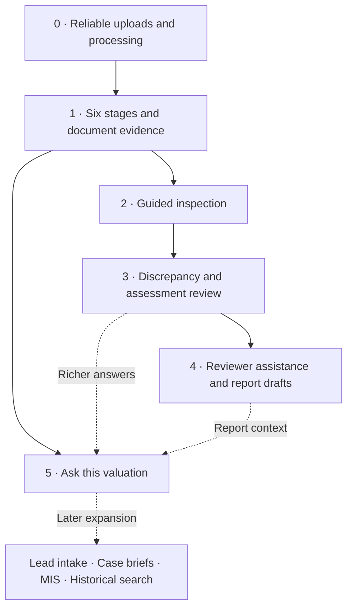

# AI valuation implementation plan

Draft for discussion — 29 September 2026.

This document proposes scope, dependencies and acceptance criteria. It does not authorize or schedule implementation. The phase order is a recommendation for discussion with the business owner.

## 1. Intended experience

The assessor works through **Documents → Property details → Inspection → Assessment → Review → Report**.

These are navigation stages over the existing valuation questions. They must preserve question IDs, option IDs, answer groups, saved answers, source evidence and report bindings. A change of layout must not create a second set of valuation answers.

The reusable interaction is:

**Source → extract → suggest → review a choice → save through existing validation → use the approved answer in the report.**

For a filled field: keep current, use suggestion, or write an answer. For an empty field: use suggestion or write an answer. Copy is independent of saving. One answer is active; previous values and source evidence remain available in history.

## 2. Starting position

| Capability | Current evidence | Work still needed |
| --- | --- | --- |
| Voice transcription and answer matching | Code uses Whisper Large V3 and Qwen through DeepInfra | Resolve and verify the previously reported S3 recording upload failure; test real audio through upload, transcription, matching, acceptance and playback |
| Document suggestions | Code handles document/page sources and evidence-linked suggestions | Evaluate representative PDFs, scans, images and tables; verify long-document handling and existing-document reuse |
| Answer choice and history | Current/suggested/own choices, copy and history implemented; targeted tests passed | Check representative grid, amounts, document and conflicting legacy-answer cases end to end |
| Required-question checklist | Implemented using submission's required-question rules | Separate site-critical information from office/post-site work; review completeness rules with valuers |
| Focused follow-ups | Live DeepInfra response and navigation verified | Make prompts contextual to a recent recording and completed answers; evaluate relevance and language |
| Photo checklist | Six existing expected categories; missing/unavailable states and uploads | Requirements by service/asset/bank, justified not-applicable decisions, and photo-content review |
| Six-stage workflow | Proposed | Map every question to a stage, retain bank sections and existing report mappings |
| Discrepancy review, report drafting, case Q&A | Proposed | Build after reliable evidence and saved-answer history are established |

The prior checks are evidence for those specific behaviors, not a declaration that all AI paths are production-ready. There are uncommitted changes in the workspace; preserve and review them before establishing a release baseline.

## 3. Proposed phases and exit conditions

Solid arrows show the recommended delivery sequence and evidence dependencies. Dashed arrows show enrichment or later expansion. Phase 5 may move ahead of Phase 4 after the shared evidence foundation is ready.

### Phase 0 — Reliable evidence capture

**Purpose:** A recording or document reaches storage, can be opened again, and can be retried without losing evidence.

Implementation:
- Diagnose the exact S3 failure with sanitized errors; verify upload, readback and playback using an isolated test object.
- Preserve unsent recordings across a page interruption where practical, with a download option and explicit saved/unsaved state. The present in-page retention is not durable offline storage.
- Separate source saving from long AI processing. Introduce durable job status and a worker, with retries, timeout handling and duplicate-request protection.
- Record provider/model, processing version, duration, usage/cost when available, and sanitized failure details. Retrying should not silently duplicate pending suggestions.
- Keep the UI usable while processing. Distinguish uploading, saved, transcribing, matching, ready and failed.
- Verify scope restrictions on sources and suggestions, and define retention rules for recordings and extracted text.

Dependencies: storage access, a representative evaluation set, and review of the current changes.

Exit: Successful real-audio and document runs; forced upload/provider failures recover; replaying a request creates no duplicate business answers; another assessor cannot access the evidence.

### Phase 1 — Six stages and reusable document evidence

**Purpose:** The assessor can find every question and reuse information from documents already attached to the case.

Implementation:
- Inventory questions by service, subtype, category, answer type and applicable bank section. Review existing applicability logic before using it as the basis for stage mapping.
- Add a navigation mapping over existing categories/questions. Start with category-level mappings; use explicit question overrides only where a category spans stages.
- Keep an “All questions” view and an unmapped queue during rollout. Every applicable question must be reachable; retired answered questions remain accessible as historical evidence.
- Let staff select existing case documents as sources rather than uploading the same file repeatedly. Enforce ownership and case scope on the server.
- Extract native PDF text where suitable; use page rendering and vision for scans. Retain page references and text spans; flag unreadable pages.
- Normalize candidate facts with their original text, units and source. Show per-question and per-section suggestions for review.
- Add “Explain this question” using question wording and reviewed guidance, without supplying a fabricated answer.

Dependencies: Phase 0's source/job contract. Question mapping can be prepared while Phase 0 is being completed.

Exit: All applicable questions mapped or explicitly visible as unmapped; IDs and answers unchanged; all answer types still save; existing PDF/report mappings remain valid; extracted facts open the correct source page.

### Phase 2 — Guided inspection and useful follow-ups

**Purpose:** Reduce missing information and repeat site visits.

Implementation:
- Extend the existing checklist rather than replacing it. Label site-critical, office and post-site tasks explicitly using reviewed rules.
- Configure expected/required photographs by service and asset type, with bank-specific exceptions only when documented.
- Add a not-applicable decision with a reason where business policy permits it. AI cannot waive a requirement.
- Ask one focused question based on a real gap. Include the answer type, recent relevant transcript and accepted answers so the prompt does not repeat completed work.
- Allow “answer now”, “record response” and “later”. A deferred item stays outstanding; it must not count as complete.
- Add suggested photo categories/captions and blur warnings. Keep staff confirmation before a category is treated as satisfied.
- Support photographed measurement sheets as editable grid proposals, preserving rows, columns and units. Calculations remain in Django.
- Provide a before-leaving summary that includes unsynced answers, pending uploads and unresolved site-critical items.

Dependencies: Phases 0–1; reviewed requirements for the selected pilot asset type.

Exit: Answering/removing an answer and uploading/removing a photo updates the checklist; prompts avoid answered questions; offline work is clearly distinguished from server-saved work; no suggestion is counted as an accepted answer.

### Phase 3 — Discrepancies and assessment evidence

**Purpose:** Make differences visible before conclusions are finalized.

Implementation:
- Compare accepted facts and source candidates for names, plot numbers, boundaries, areas, units, dates and occupancy.
- Use deterministic checks for arithmetic, unit conversion and exact identifiers. Use AI to explain ambiguous differences and propose where to look next.
- Show conflicting source values side by side with their pages/timestamps. Let the valuer choose or enter a value with a reason.
- Extract candidate rows from rate-reference documents, preserving location, date, units, conditions and source page. The valuer selects applicability and the final rate.
- Track findings as open, resolved or acknowledged, and re-evaluate them when underlying answers change.

Dependencies: Phase 1's traceable evidence and normalization; reviewed comparison rules.

Exit: Seeded mismatches are detected; equivalent units do not create false conflicts; no automatic replacement of accepted values; rate suggestions remain traceable to the supplied reference.

### Phase 4 — Reviewer assistance and report drafts

**Purpose:** Reduce report preparation and correction time while preserving the existing approval process.

Implementation:
- Add a review summary of incomplete requirements, unresolved discrepancies and evidence gaps.
- Draft narrative sections only from accepted answers. Highlight any area without sufficient evidence instead of inventing narrative detail.
- Link reviewer feedback to the question and supporting source, preserving the existing revert/resubmit process.
- Store versioned narrative drafts against a snapshot/version of the underlying answers. Editing an input marks dependent drafts stale.
- Generate PDFs with controlled templates and deterministic totals. Approved reports must be reproducible from an approved answer/draft snapshot.

Dependencies: Phases 1 and 3; selection of the first report template; confirmation of who approves narrative changes.

Exit: Report numbers, tables, units, question-answer bindings and approval behavior are preserved; changed inputs invalidate the old draft; no unapproved AI narrative reaches an issued report.

### Phase 5 — Ask this valuation

**Purpose:** Answer questions such as “Where did this area come from?” and “What is still blocking submission?”

Implementation:
- Retrieve only evidence and saved records within the user's permitted case. Apply scope before retrieval, not after generating a response.
- Return citations to questions, pages or timestamps. For unsupported questions, say that evidence is missing.
- Use ordinary approved queries for completion/status questions; retrieval over evidence for source questions.
- Start with read-only assistance. Any later write action must use a separate reviewed business command.

Dependencies: Phase 1; Phases 3–4 provide richer discrepancy and review answers. This phase can move ahead of Phase 4 if evidence lookup is the larger business priority.

Exit: No cross-case or cross-user leakage; citations open the supporting source; status/count answers match backend results; unsupported claims are not presented as facts.

### Later extensions — Wider lead-management assistance

- Lead intake: extract a draft lead/client/borrower/service request from a bank instruction, with duplicate checks and confirmation before creating records.
- Case brief: summarize existing case history and recorded actions, linking back to the timeline.
- MIS assistant: translate questions into a catalog of approved reporting queries; display filters and calculation definitions. Do not give the model unrestricted database execution.
- Historical-case search: retrieve comparable records with dates, sources and scope restrictions. Past values are references, not automatically valid current rates.

These are separate workstreams. They do not need to delay the assessor workflow.

## 4. Architecture and data plan

Preserve existing `Document`, `AssistSource`, `Suggestion`, `ValuationAnswer` and audit records. Introduce data structures only when their phase needs them; this is not a proposal to add all tables immediately.

| Proposed entity/change | Business purpose | Introduce when |
| --- | --- | --- |
| AI processing job, or equivalent durable job metadata | Track retryable work and the exact provider/model/version used | Phase 0 |
| Category/stage mapping, with optional question override | Group questions without changing their identity | Phase 1 |
| Evidence segment/fact | Link extracted text or a normalized value to a page, timestamp and source version | Phase 1 |
| Inspection requirement rule | Define site-critical questions and photos for a service/asset/bank | Phase 2 |
| Requirement exception | Record permitted not-applicable decisions and reasons | Phase 2 |
| Review finding | Preserve a discrepancy, its sources and the valuer's resolution | Phase 3 |
| Report narrative revision | Preserve draft text and the approved input version it uses | Phase 4 |
| Retrieval index | Find relevant evidence; rebuildable from authoritative records | Phase 5 |

Keep valuation decisions in `apps.valuations`, files in `apps.documents`, report drafts in `apps.reports`, and MIS queries in `apps.analytics`. A shared AI integration module may own provider calls/jobs when several domains use it. It should not own the valuation's business rules.

React shows progress and choices. Django enforces access, question/option validity, expected-answer concurrency checks, business calculations and persistence. A worker performs lengthy extraction/matching. DeepInfra supplies model output; it does not connect directly to the business database.

## 5. Evaluation and rollout

Proposed initial evaluation set: 20 representative cases, selected with the business owner. Include Hindi/English speech, noise, short recordings, clear and poor scans, native PDFs, grids, empty forms and conflicting existing answers. This is an initial pilot, not proof of accuracy across every service.

Measure per capability: valid suggestions, staff corrections, unsupported statements, missed critical facts, time to finish, failure/retry frequency and cost per case. Agree numeric acceptance targets after measuring the baseline; do not invent an accuracy claim from passing mocked tests.

Rollout: development tests → evaluation set → small assessor/reviewer pilot → controlled expansion by service/template. Use feature switches to disable an AI capability while preserving manual work and saved evidence.

Every phase needs a permissions check, failure-path check, mobile check and a demonstration using representative data. Requirements and report calculations require deterministic tests; model quality requires recorded evaluation results.

## 6. Decisions for the next planning discussion

1. Which service/asset/bank template should be the pilot? A land-and-building workflow is a candidate, not a confirmed selection.
2. Is the largest current delay typing during inspection, reading documents, reconciling conflicting values, or drafting reports?
3. Which questions and photographs are truly required before leaving the site, and who can approve exceptions?
4. Which 20 cases can form the evaluation set, and who will assess the suggestions?
5. What is the acceptable AI cost per case and response time?
6. Who approves report narrative changes, and which template should be first?

Recommended first package for discussion: **Phase 0 + the question-mapping inventory from Phase 1**. Next choose between completing document assistance and deepening the inspection assistant based on the pilot team's main bottleneck. Do not commit to dates until the storage issue, mapping size and pilot scope are known.
