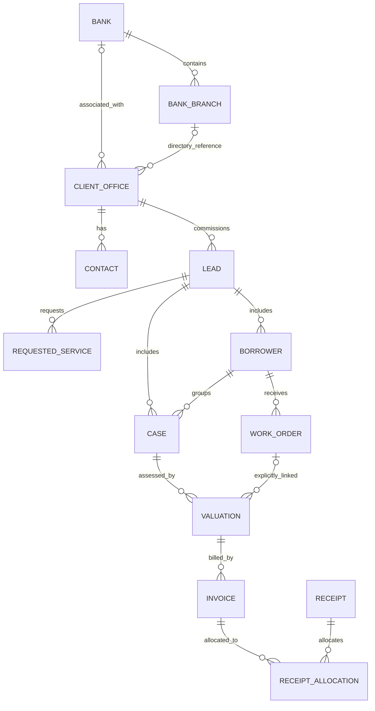

# Proposed clean Django database design

**Updated owner direction:** Do not migrate historical attendance; build it fresh. Preserve payroll results, salary baselines and leave-balance evidence separately. See [CLEAN_TARGET_STATUS.md](../data-migration/CLEAN_TARGET_STATUS.md) for the 27 implemented managed entities and [BUSINESS_ENTITIES.md](../data-migration/BUSINESS_ENTITIES.md) for the complete review of the 202 highlighted sources. The monthly-consolidation plan below is the prior design and is no longer the historical import plan.

Status: first design and complete source-disposition inventory. No consolidation has been applied. The restored seven-schema database remains the migration reference. This document supersedes carrying the generated 982-table compatibility layer forward as the final application schema.

## What the inventory establishes

Of 982 source tables, 402 are in UAT schemas and 580 are in main schemas. UAT will use a separate database/environment running the same new Django migrations. Its historical data remains separately preserved; main/UAT structures currently differ, so this is not permission to mix their rows.

The 580 main-schema tables have this preliminary disposition:

| Disposition | Source tables | Meaning |
|---|---:|---|
| Monthly consolidation candidates | 377 | Five logical families, requiring layout and overlap checks |
| Domain entity candidates | 142 | Map to named Django business entities; some share a proposed target |
| Archive candidates | 28 | Names suggest backups/snapshots; usage and unique-row review required |
| Further domain review | 32 | Retain until business purpose and consumers are established |
| Invalid period requiring review | 1 | attendance_132021 must not be interpreted as a calendar month |

These are source classifications, not a final target-table count. New tables may be required for payment allocations, permission scopes, migration identity and audit trails. Reducing table count must not combine entities with different identities or lifecycle rules.

The full register is [SOURCE_TO_TARGET.md](../data-migration/SOURCE_TO_TARGET.md); the machine-readable register is [target-disposition.json](../data-migration/target-disposition.json). Every source table appears exactly once, including unresolved and UAT entries. Classification rules are in `design_target.py`. Backup classifications are name-based candidates, not proof of non-use.

## Monorepo and data ownership

One Django backend, one React frontend, one coherent production schema managed by Django migrations. Keep domain boundaries through Django apps, not through a separate deployment for each old Java project. Database engine selection and production topology are separate decisions; the current MariaDB restore is the source reference, not a mandate for the redesigned target.

| Django app | Primary responsibility | Main proposed entities |
|---|---|---|
| identity | Login, roles and access scopes | User, Role/Group, Permission, UserScope, legacy identity map |
| organization | Organizational and geographic structure | Department, Location, jurisdiction/reference entities, reporting structures |
| reference | Shared external master data | Bank, BankBranch and reviewed classification lists |
| crm | Commissioning offices and relationships | ClientOffice, ClientType, Contact, CqntactDesignation, RelationshipOwner |
| leads | Request capture and case tracking | Lead, RequestedService, Borrower, Case, FollowUp, Assignment |
| services | Service catalogue | ServiceType, ServiceSubtype |
| workorders | Work instructions and commercial agreement | WorkOrder, WorkOrderRevision, FeeRule |
| valuations | Valuation inputs and review workflow | Valuation, Question, QuestionOption, Answer, Review, Reversion |
| reports | Versioned report templates and issuance | TemplateVersion, TemplateQuestion, Heading, BankReport, Dispatch |
| billing | Billing and collection lifecycle | Invoice, InvoiceLine, Receipt, ReceiptAllocation, charge types and revisions |
| documents | File metadata and entity attachments | Document, storage reference, explicit attachment/link tables |
| hr | Employees and employment changes | Employee, designation, assignments, Transfer, identity/bank details and revisions |
| attendance | Device events and interpreted attendance | Device, DevicePerson, DeviceEvent, DailyRecord, DailyStatus, StatusRevision, EmployeeApplication |
| leave | Leave requests and approval | LeaveType, LeaveRequest, Approval, request revision |
| payroll | Pay configuration and pay runs | SalaryConfiguration, Component, PayHead, PayRun, PayRunItem, Deduction, Approval |
| messaging | Notifications and delivery evidence | Notification, Recipient, DeliveryLog, delivery attempt/outbox when needed |
| audit | Traceable business changes | AuditEvent and domain revisions requiring structured fields |
| migration | Import lineage and reconciliation | ImportBatch, SourceIdentity, ReviewIssue, ArchiveManifest |

This list describes proposed ownership, not completed models. Accounts functionality must be traced against its source before defining accounting journals or balances; names alone are insufficient. MIS should primarily query these entities through reporting services/views, not create duplicate master tables for each report.

## Consolidation with the largest impact

| Proposed family | Main source tables | Source rows | Distinct column layouts |
|---|---:|---:|---:|
| attendance.daily_record | 69 | 71,332 | 2 |
| attendance.daily_status | 73 | 36,771 | 2 |
| attendance.device_event | 99 | 46,005 | 5 |
| attendance.employee_application | 69 | 11,813 | 1 |
| attendance.status_revision | 67 | 4 | 1 |

These figures cover matched monthly tables only. Unpartitioned tables and backup candidates are accounted for elsewhere in the register. Five logical families does not mean all attendance functionality can fit into five tables.

For each family:

1. Compare every column layout and identify what each date means by tracing the code and attendance procedure.
2. Map original fields to the proposed schema. Preserve extra fields and exceptions until there is an explicit conversion rule.
3. Record original schema/table/key and source period. A period derived from a name is a provenance hint; prefer verified row dates for business activity.
4. Check overlapping events between schemas and monthly/unpartitioned tables. Never assume equal IDs, employee names, or timestamps prove duplicates.
5. Import with explicit collision handling. Device events may legitimately repeat; retain source provenance and device identity.
6. Reconcile counts, date ranges and payroll/attendance outcomes before replacing old readers.

Proposed core fields:

| Entity | Essential fields and relations | Uniqueness rule |
|---|---|---|
| DeviceEvent | target ID, device, device-person identity, event timestamp, event/direction code, source identity | Unique source identity; business-event deduplication pending evidence |
| DailyRecord | target ID, employee, attendance date, shift/reference, observed inputs and computed result | Employee/date/shift rule must be confirmed; don't impose employee/date alone |
| DailyStatus | daily record or employee/date reference, status code, approval state | Status lifecycle determines whether multiple versions are allowed |
| StatusRevision | original status reference, prior/new state, actor, event time and source identity | Append-only event identity |
| EmployeeApplication | employee, application type, dates, requested change, workflow state and approvals | Source identity; no assumption of one application per day |

No new month-specific model or migration should be created. Add date indexes, and consider database partitioning only if measured volume warrants it; physical partitions do not become separate Django entities.

## Core lead relationships to retain

This is a target design, not a claim that all source relationships are enforced or valid. Unresolved source links are preserved in review records before target constraints become mandatory.

ClientOffice is the commissioning identity. An official bank branch is a directory entry; do not merge these solely by name or IFSC. Borrower, case, work order and valuation remain separate because they represent different grains. Valuation links must follow the explicit source IDs, not a multiplying join on borrower.

ReceiptAllocation is proposed to support explicit invoice allocation and prevent applying the same receipt twice. The two legacy receipt paths and offline invoices/receipts stay distinct during reconciliation. They can converge only after a mapping proves their identities and applied-payment semantics. Agreed borrower fees, invoiced value and receipts remain separate measures.

## Shared data, documents and audit

- Use one Document entity design for storage metadata, with source-specific attachment mappings. Keep storage provider, bucket/container, object key or relative path, checksum, byte size and media type. Source upload IDs from lead and UAM are not interchangeable. File bytes need a separate migration.
- Use one delivery-log design where appropriate, preserving channel, source application, recipient and outcome. Historical delivery logs do not constitute consent or imply an active messaging integration.
- Keep employee identity separate from Django login accounts. Joining them requires an explicit reviewed mapping; source passwords and roles are not automatically valid in the new application.
- Keep domain history needed for payroll, work orders, approvals and financial traceability. Generic audit events may supplement this, but must not replace structured revisions needed to reproduce historical results.
- Version report templates instead of keeping dated backup tables in the active schema. A backup may contain the only surviving version needed to reproduce a report; archive eligibility must be determined before excluding it.

## Identity and migration contract

New business entities receive independent target IDs. The migration identity ledger records source environment, schema, table, original key, target entity and target ID. Composite keys are encoded as ordered typed values, not concatenated ambiguous strings. For keyless tables, preserve each row as a distinct occurrence in the immutable snapshot; hash equality alone must not collapse legitimate duplicate rows. Matching keyless records across future snapshots needs a reviewed rule.

An idempotent import means the same approved source snapshot and conversion version can be rerun without duplicate targets. Source-owned changes must not overwrite target-owned notes, tasks or permissions. Track inserted/updated/unchanged/unresolved counts and preserve before-images or a rollback strategy for committed updates.

No source table is deleted by classification. Archive candidates retain original DDL/data and a manifest. Only after proving active readers/writers no longer depend on them and preserving unique historical data should they be excluded from the production application schema.

## Database implementation sequence

1. Complete column-level contracts for the five repeated attendance families and the lead/client/service chain. Investigate the invalid-period table and the 32 unresolved main tables.
2. Trace source consumers and routines for proposed archival/shared entities. Evaluate foreign-key and cross-entity inconsistencies without guessing repairs.
3. Create managed Django models in the new domain apps, with migrations that build a clean target database independently of the restored source.
4. Import in dependency order into that separate target, preserving identity lineage and exceptions. Keep main and UAT isolated.
5. Verify field-level values, duplicate/collision handling, monetary totals, historical reporting and rollback behavior. Row counts alone are insufficient when merging tables.
6. Switch backend services to the target only after their workflows pass tests. Continue React work after these database contracts are stable.

The final table count will be reported from the approved managed Django models. It is deliberately not estimated by subtracting the candidate categories above.
