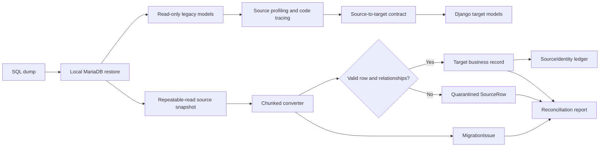

# OMEN database migration method

**Document date:** 17 September 2026  
**Purpose:** Explain the method used to move legacy OMEN data into the clean Django schema, and define the same controlled process for adding the remaining source tables.

## 1. Scope and terminology

The supplied SQL dump contains seven schemas, 982 tables, and 7,998,004 rows. The migration does **not** reproduce those 982 tables in Django. The legacy database is the preserved source of evidence; the Django database is a redesigned business model.

There are three different coverage numbers:

| Coverage | Meaning |
|---|---|
| 982 source tables | Every table in the restored dump was inventoried and assigned a preliminary disposition. |
| 202 highlighted main-schema tables | Tables selected for detailed business review: 142 domain candidates, 28 backup/snapshot candidates, and 32 requiring investigation. |
| 61 imported source tables | Tables currently implemented in the direct MySQL-to-Django importer: 41 from `lead_mngt` and 20 from `uam_user`. |

The committed 61-table import report records 2,537,219 source rows. Of these, 2,537,011 became target business records and 208 remain quarantined with their original payload. This is 99.992% technical acceptance. It does not by itself prove workflow or reporting parity.

Historical attendance was deliberately excluded at the owner's direction. Payroll results and salary setup evidence are retained independently of attendance. Production and UAT remain separate environments and their rows are never merged implicitly.

## 2. Migration principles

The method follows these rules:

1. **Never modify the legacy source.** Django source models and database routing reject writes. The importer opens a read-only source transaction.
2. **Design around business entities.** A target table represents a stable business concept, not necessarily one old table.
3. **Preserve provenance.** Every accepted target record retains its source schema, table, key, import batch, and target identity.
4. **Preserve rejected input.** Invalid or unresolved rows are quarantined with their complete source payload; they are not silently discarded.
5. **Do not invent relationships.** Required missing parents cause quarantine. Optional unresolved relationships are left empty and recorded as issues.
6. **Keep local application data separate.** Imported fields may be refreshed without overwriting target-owned notes, permissions, or other local fields.
7. **Make reruns safe.** Stable source identities and deterministic target UUIDs prevent duplicate target records.
8. **Reconcile, do not trust counts alone.** Row counts, relationships, monetary totals, dates, duplicate behavior, workflow meaning, and UI behavior all require validation.

## 3. Migration architecture



The source and target are separate databases:

- **Source:** local MariaDB restored from the SQL dump. It is configured only with `config.full_database`.
- **Target:** Django-managed database using `target_core` models and migrations.
- **Application:** normal API and React operation use only the target database after import.

The main implementation is in:

- `backend/target_core/models.py` — target entities and migration audit models.
- `backend/target_core/sync.py` — mapping contracts, conversion, relationship handling, batching, and reconciliation.
- `backend/target_core/management/commands/sync_legacy.py` — operator command.
- `backend/config/full_database.py` — opt-in local source configuration.
- `backend/legacy/` — generated read-only source access.

## 4. Phase A — Restore and establish the source baseline

The dump was restored into an isolated local MariaDB service. Verification captured:

- Schema, table, column, primary-key, index, and foreign-key metadata.
- Exact table row counts.
- Views, triggers, and stored procedures.
- Tables without primary keys and tables with composite keys.
- Main and UAT schemas as separate environments.

The source baseline is recorded in:

- `migration-required/data-migration/verification.json`
- `migration-required/data-migration/object-verification.json`
- `migration-required/data-migration/mapping-catalog.json`
- `migration-required/data-migration/README.md`

These reports establish what exists in the snapshot. They do not establish what should exist in the new product.

## 5. Phase B — Classify every source table

Every source table received one preliminary disposition in `migration-required/data-migration/target-disposition.json` and `migration-required/data-migration/SOURCE_TO_TARGET.md`:

- Retain as a business-domain candidate.
- Consolidate repeated or period-partitioned tables.
- Preserve and reconcile historical/snapshot evidence.
- Archive after confirming no active dependency.
- Investigate further.
- Exclude by an explicit business decision, such as historical attendance.

Names are never treated as sufficient proof. For example, `employee_salary_backup` and `employee_salary_main_backup` are used by payroll code, so they were retained as operational salary evidence despite the word “backup.”

The classification stage does not delete any source data. The original dump remains the recovery and audit reference.

## 6. Phase C — Understand business meaning before mapping

For each candidate table, the migration review examines:

1. Columns, key structure, nullability, indexes, and row counts.
2. Foreign keys declared in the database and relationships implied only by application code.
3. Java controllers, services, DAOs, SQL, JSP forms, and report queries that read or write it.
4. Status codes, date meaning, monetary meaning, and lifecycle transitions.
5. Duplicate IDs, invalid references, snapshot variants, and obsolete rows.
6. Whether the source represents a master, transaction, history, attachment, configuration, or derived report.

This code-tracing step was especially important for valuation answers. Their EAV structure was retained because the question set varies by service and subtype. Repeating grids rely on `answer_group`; flattening the answers would lose row structure and historical form meaning.

## 7. Phase D — Design the clean Django target

Target entities are created around distinct business identities and lifecycles. Examples:

- Bank directory records are separate from commissioning client offices.
- Lead, borrower, case, work order, valuation, invoice, and receipt remain separate grains.
- Employees are separate from Django login accounts.
- File metadata is separate from business attachments and from the file bytes themselves.
- Receipts are not automatically treated as reconciled invoice allocations.
- Valuation questions, options, answers, reviews, reversions, and attachments remain independently traceable.

Target models use Django migrations. A source ID is not reused as the target primary key. Target rows receive UUIDs, while `SourceIdentity` records the legacy identity.

The clean target also contains four migration controls:

| Control | Purpose |
|---|---|
| `ImportBatch` | Records one migration attempt, conversion version, checksum, status, and summary. |
| `SourceIdentity` | Maps environment/schema/table/source key to the target model and UUID. |
| `SourceRow` | Retains the latest complete source payload, hash, outcome, and problems. |
| `MigrationIssue` | Records warnings and errors for review and later resolution. |

## 8. Phase E — Define an explicit source-to-target contract

Each imported source table has one specification in `SPECS` inside `backend/target_core/sync.py`. A specification declares:

```text
source schema
source table
source key column
target Django model
target scalar field -> source column mappings
target foreign key -> parent source table/source column/optional flag
```

Example in conceptual form:

```text
lead_mngt.lead
  key: lead_id
  target: Lead
  fields: lead_no -> number, lead_date -> received_date, ...
  links: client_id -> ClientOffice (required),
         orderer_reg_id -> Contact (optional),
         assigned_to -> Employee (optional)
```

The specification order follows dependencies: parent/master data first, then child and transaction data. This ensures that parent source IDs can be resolved while importing children.

Some rules cannot be expressed as a direct column map and are implemented as named transformations or validations, for example:

- Date parsing and invalid-date warnings.
- Decimal and non-negative count validation.
- Service/subtype consistency.
- Lead/borrower/case/work-order consistency.
- Valuation/work-order consistency.
- Storage-provider classification.
- Source status preservation.

Every such rule must have a business explanation and a regression test. A rule that repairs source data must retain the original value and disclose the repair.

## 9. Phase F — Read a consistent, source-safe snapshot

The import command connects to the restored MariaDB schemas using a dedicated local connection file that is excluded from source control.

The importer:

1. Confirms the configured source engine is MySQL/MariaDB.
2. Starts a repeatable-read, read-only transaction with a consistent snapshot.
3. Reads only tables explicitly listed in the import allowlist.
4. Never calls INSERT, UPDATE, DELETE, or schema migration operations against the legacy aliases.
5. Rolls back the source transaction when reading finishes.

Snapshot guarantees must be checked for each source storage engine. A MyISAM table does not receive the same transactional snapshot guarantees as InnoDB; the current local restore is treated as immutable during migration runs.

## 10. Phase G — Process rows in bounded chunks

Large tables cannot be loaded wholly into memory. The importer uses keyset pagination in primary-key order, currently with chunks of 100,000 rows.

For every chunk it:

1. Reads rows in stable source-key order.
2. Builds canonical source keys.
3. Loads only the relevant existing identities, target records, and staged source rows.
4. Converts and validates every row.
5. Writes target rows, identity records, payload records, and issues in database batches.
6. Releases chunk-specific state before reading the next page.

Keyset pagination uses `WHERE key > last_key ORDER BY key LIMIT size`. It avoids the increasing cost of large OFFSET values and supports a deterministic source checksum.

Tables without a stable unique ordering need a separate approved strategy. They must not be added to this path by pretending a non-unique column is a primary key.

## 11. Phase H — Convert one source row

For each row, the importer follows this decision sequence:

1. **Validate the source contract.** All key, mapped field, and relationship columns must exist.
2. **Build the source identity.** The source key is encoded canonically and namespaced by environment, schema, and table.
3. **Detect duplicates.** Duplicate source keys abort the batch; the importer does not choose one arbitrarily.
4. **Retain the payload.** The complete source row is serialized and hashed before conversion.
5. **Convert scalar values.** Text, date, decimal, and integer values are normalized and checked against target-field validators.
6. **Resolve relationships.** Parent source IDs are looked up through records already imported during the batch.
7. **Apply semantic validation.** Cross-field and cross-entity business relationships are checked.
8. **Choose the outcome.** The row becomes inserted, updated, unchanged, or quarantined.
9. **Record warnings.** Optional missing links and non-fatal conversion problems are preserved in `MigrationIssue` and `SourceRow.problems`.

New target UUIDs are deterministic: the importer generates them from a fixed UUID namespace plus the source schema, table, and canonical key. Reprocessing the same source identity therefore selects the same target identity.

## 12. Required and optional relationships

Relationship handling is explicit in each mapping:

- A **required** missing or quarantined parent prevents the child from becoming an active target business record. The child is quarantined with the original payload.
- An **optional** missing parent leaves the target field empty and records a warning when the source value was populated.
- A semantic conflict can quarantine the row, clear an optional link, or apply a reviewed remapping rule. The chosen behavior must be documented for that relationship.

Quarantine can cascade. For example, an answer referencing a missing valuation is quarantined even when the answer row itself is structurally valid. Reconciliation must distinguish a direct dangling foreign key from a child blocked by an earlier quarantined parent.

Numeric-looking legacy keys require care. Some source columns store zero-padded strings. Normalization must be applied once and reused by both relationship resolution and later semantic checks; inconsistent normalization can create false unresolved references or abort a batch.

## 13. Valuation EAV migration

The valuation form is dynamic, so it remains in an entity-attribute-value structure:

```text
Valuation
  -> Question
     -> QuestionOption (when applicable)
     -> ValuationAnswer
        - answer_group: repeating row number
        - value: entered value
        - option: optional configured column/choice
        - document: optional uploaded evidence
```

Legacy renderers establish the form behavior:

- Answer types 1 and 2 use configured options.
- Type 3 is free text.
- Types 4 and 6 are repeating grids; `answer_group` preserves each grid row.
- Type 5 is a numeric attribute table with a displayed total.

Answers are not deduplicated by valuation/question/group/option because the source contains legitimate or historically significant repetitions. The source `answer_id` is the migration identity.

Validation must also ensure that a referenced option belongs to the same question as the answer. Unresolved options must be profiled by answer type before anyone claims that the reconstructed valuation form is complete.

## 14. Insert, update, and preservation behavior

The importer does not truncate target tables before a refresh.

- **Insert:** no `SourceIdentity` exists; create the deterministic target UUID and identity record.
- **Update:** the identity exists and at least one import-owned target value changed.
- **Unchanged:** the identity exists and all import-owned values match.
- **Quarantined:** required validation fails; keep the payload and problems without creating or corrupting the business row.

If a previously accepted row later becomes invalid, its source evidence is updated in `SourceRow`, but an invalid correction must not blindly overwrite a known-good target record.

Rows missing from a later snapshot are retained. Absence is not interpreted as deletion. A future deletion or deactivation policy requires explicit source semantics and business approval.

Target-owned values are excluded from bulk updates. Examples include local lead notes and client-office ownership entered in the new application.

## 15. Transactions and failure handling

One target import batch runs inside a Django database transaction:

- If conversion or persistence fails unexpectedly, target business changes roll back.
- The `ImportBatch` is marked failed outside the rolled-back transaction with a safe diagnostic summary.
- A dry run deliberately rolls back its target writes after producing the proposed reconciliation result.
- A successful run stores its checksum and per-table summary on the committed `ImportBatch`.

This protects the target from partially applied imports. It does not replace a target backup and restore plan for production cutover.

Only one import job should run at a time until an explicit cross-process lock is implemented and tested.

## 16. Reconciliation report

Every table reports:

| Counter | Meaning |
|---|---|
| `source_rows` | Rows read from the source snapshot. |
| `inserted` | New accepted target records. |
| `updated` | Existing accepted targets whose import-owned values changed. |
| `unchanged` | Existing accepted targets already matching the source. |
| `quarantined` | Rows withheld from active target records due to required failures. |
| `rows_with_issues` | Accepted or quarantined rows carrying at least one warning/error. |

For each table:

```text
inserted + updated + unchanged + quarantined = source_rows
```

Reports use schema-qualified table names so tables such as `lead_mngt.upload` and `uam_user.upload` cannot overwrite each other in the report.

The current committed full-import evidence is `migration-required/import-runs/imports/target-import-final.json`. It records 61 tables and 2,537,219 source rows. Reports must not contain database credentials or complete source payloads.

## 17. Execution sequence

Run commands from `omen-next/backend`. The first command confirms target schema migrations. The next commands validate, preview, import, and prove repeatability.

```sh
.venv/bin/python manage.py migrate
.venv/bin/python manage.py check
.venv/bin/python manage.py test
.venv/bin/python manage.py test --settings=config.target
.venv/bin/python manage.py makemigrations --check --dry-run

.venv/bin/python manage.py sync_legacy \
  --settings=config.full_database \
  --dry-run \
  --report ../migration-required/import-runs/dry-runs/target-dry-run.json

.venv/bin/python manage.py sync_legacy \
  --settings=config.full_database \
  --report ../migration-required/import-runs/imports/target-import.json

.venv/bin/python manage.py sync_legacy \
  --settings=config.full_database \
  --dry-run \
  --report ../migration-required/import-runs/repeat-proofs/target-repeat.json
```

Expected repeat-run behavior is zero unintended inserts and zero unintended updates. Quarantined rows may appear again until their relationships or mapping rules are resolved. The full 61-table repeat report must be retained as acceptance evidence.

## 18. Validation gates

A table is not considered fully migrated merely because its rows were inserted. It passes only when the applicable checks succeed:

### Structural checks

- Django migrations apply from a clean database.
- No uncommitted migration drift exists.
- Database foreign-key checks pass.
- Target uniqueness and protection rules match business identity and lifecycle.

### Data checks

- Source and outcome counts reconcile.
- Source IDs resolve to exactly one target identity.
- Required relationships are complete or explicitly quarantined.
- Optional-link warnings have been reviewed.
- Dates, decimal precision, tax amounts, status values, and text truncation are reconciled.
- Duplicate and keyless-row behavior is documented.

### Semantic checks

- Relationships agree with legacy workflow code, not only source column names.
- Valuation options belong to their questions.
- Case, borrower, lead, work order, and valuation identities agree.
- Invoice, receipt, and allocation meanings are not conflated.
- Storage provider and path meaning reflect the correct source application.
- Report totals and selected historical examples reproduce expected legacy outcomes.

### Repeatability and failure checks

- First import, exact repeat, source correction, missing source row, duplicate key, required orphan, optional orphan, dry run, and unexpected failure are covered by tests.
- Duplicate keys spanning chunk boundaries are rejected.
- A failed import leaves no partial business changes.
- Target-owned notes and permissions survive refresh.

### Application checks

- Authenticated API access, permissions, CSRF, pagination, search, and note creation work against the target.
- React displays accepted, warned, and quarantined data honestly.
- Browser workflows use the target models rather than archived prototype tables.

## 19. Method for adding another source table

Use this checklist for every remaining table:

1. Confirm its disposition and owner in the inventory.
2. Profile keys, columns, counts, nulls, duplicates, date ranges, and candidate links.
3. Trace every active reader and writer in the legacy code.
4. Define its business grain and decide whether it maps to an existing target entity, a new entity, a version/history entity, or archive-only evidence.
5. Write a field-level contract, including status/date/amount meanings.
6. Define the source key. For composite keys, encode ordered components. For keyless tables, design an occurrence-preserving identity rule.
7. Add or alter the Django model through a migration.
8. Add the source mapping in dependency order using schema-qualified parent references.
9. Add table-specific semantic validations and transformations.
10. Add tests for clean data, invalid data, corrections, reruns, and local-field preservation.
11. Run a dry run and review every warning and quarantine reason.
12. Run the import, compare samples and aggregates, and run a complete repeat dry run.
13. Expose the entity through APIs/UI only after its workflow and permissions are validated.
14. Update the coverage register and completion report with evidence.

## 20. Current 61-table import scope

### `lead_mngt` — 41 tables

`account_detail`, `amount_received`, `billing_head`, `cash_receipt`, `client`, `client_customer`, `client_designation`, `client_type`, `detail_category`, `division`, `employee_tagging`, `employee_target`, `follow_up`, `ifsc`, `invoice`, `invoice_follow_up`, `lead`, `lead_borrower`, `lead_order`, `lead_order_history`, `lead_services`, `lead_upload`, `offline_amount_received`, `offline_invoice`, `orderer_reg`, `party`, `question`, `question_options`, `revert_back`, `scrutiny_document`, `service_sub_type`, `service_type`, `sub_division`, `upload`, `usage_documents`, `valuation`, `valuation_answer`, `valuation_billing`, `valuation_photo`, `valuation_verification`, `wo_fees_calculation`.

### `uam_user` — 20 tables

`bank`, `bank_branch`, `block`, `circle`, `city`, `district`, `division`, `employee`, `employee_salary_backup`, `employee_salary_main_backup`, `employee_salary_summary`, `location`, `official_location`, `panchayat`, `region`, `state`, `sublocation`, `upload`, `upload_sys`, `village`.

## 21. Deliberate exclusions and remaining work

The following are not implied by the 61-table import:

- The other 921 source tables have not all become target business records.
- Historical attendance is excluded and will start fresh if that module is implemented.
- UAT data is not merged into production/main data.
- File metadata import does not copy or verify S3/local file bytes.
- Receipt links are not the same as reconciled financial allocations.
- Imported valuation answers do not yet prove complete form rendering or report parity.
- Prototype accounts and notes require a separate reviewed adoption process.
- Complete APIs, React workflows, permissions, MIS reports, deployment, and production cutover remain separate acceptance phases.

## 22. Known review findings before final acceptance

The latest independent review identified issues that must be closed before declaring the migration complete:

- Validate that every valuation answer option belongs to the answer's question; two imported target relationships failed this check during review.
- Profile 11,567 unresolved valuation option references by answer type.
- Reuse normalized legacy keys consistently in later semantic checks.
- Classify LEAD and UAM document storage providers separately.
- Add dedicated importer and API regression coverage.
- Complete the prototype account/note adoption path.
- Surface mapping warnings in the API/UI.
- Retain a zero-change repeat report covering all 61 tables.

Details and acceptance criteria are in `REVIEW_CLAUDE_DEVIN.md` at the project root.

## 23. Completion definition

The database migration is complete only when:

1. Every retained source domain has an approved target representation or archive treatment.
2. Every implemented table has field-level mapping and business validation evidence.
3. All source counts reconcile to accepted, quarantined, or approved archive outcomes.
4. Full repeat imports are idempotent.
5. Financial, payroll, valuation, document, and MIS examples reproduce agreed results.
6. Application workflows and permissions operate only on the target schema.
7. File data and external integrations are migrated and verified separately.
8. Cutover, rollback, backup, monitoring, and post-cutover reconciliation are tested.

Until those conditions are met, the current work is a substantial, traceable migration foundation rather than a complete replacement of every legacy function.
